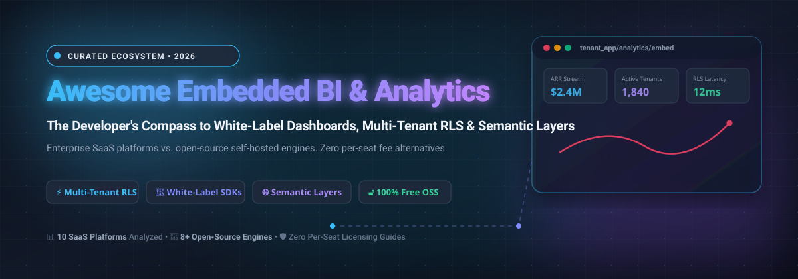

  

# 📊 Awesome Embedded Business Intelligence & Analytics

  
  
  
  
  

---

## ⚡ Top Embedded Business Intelligence & Analytics Ecosystem

**Curated List of SaaS Platforms & Open-Source GitHub Projects**  
*Focused on White-Label Dashboards, Multi-Tenant Row-Level Security (RLS) & Self-Hosted Embedding*  
**Last updated: March 2026** 🚀

> **SEO Keywords & Search Topics:** Embedded Business Intelligence, Embedded Analytics, White-Label Dashboards, Customer-Facing Analytics, Multi-Tenant RLS, Self-Hosted BI, Open-Source Semantic Layer, Apache Superset Embedding, Metabase Pro Embedding, Cube Core Headless BI, Power BI Embedded, Looker Embedded, Tableau OEM, Sisense Compose SDK.

This comprehensive repository tracks notable **SaaS platforms** and **open-source developer engines** for **Embedded Business Intelligence & Analytics**. These frameworks let engineering teams integrate interactive dashboards, customizable charts, semantic modeling layers, and self-service exploration directly into customer-facing web and mobile applications—ranging from per-viewer SaaS SDKs to open-source systems self-hosted without per-seat licensing fees.

🎯 **Leading Industry Platforms** include Power BI Embedded, Looker Embedded, Tableau Embedded, Zoho Analytics, ThoughtSpot Everywhere, Sisense, Domo Everywhere, GoodData, Qrvey, and Luzmo.

💡 **Open-Source & Self-Hosted Focus**: This curated catalog highlights battle-tested open-source repositories for self-hosted embedded BI, headless semantic APIs, and community-driven white-label reporting engines—engineered specifically for SaaS founders and data architects seeking to avoid punitive per-viewer pricing tiers that scale against software revenue.

🤝 **Contributions welcome!** Please open a Pull Request to suggest new tools or refine verified pricing metrics. Keep entries objective and link to official documentation.

---

## 📑 Table of Contents
- [🌐 Sector Overview & Market Dynamics](#-sector-overview--market-dynamics)
- [🏢 SaaS & Hosted Commercial Platforms](#-saas--hosted-commercial-platforms)
- [🔓 Open-Source GitHub Projects](#-open-source-github-projects)
- [📈 Star History](#-star-history)
- [💖 Support](#-support)
- [🛠️ How to Contribute](#️-how-to-contribute)
- [⚠️ Disclaimer & Risk Factors](#️-disclaimer--risk-factors)

---

## 🌐 Sector Overview & Market Dynamics

The global embedded analytics and business intelligence market is estimated between **$27 billion and $86+ billion** (with broad BI and analytics implementations projected to surpass **$200 billion** by the 2030s at an annual compound growth rate of ~13–16%). The sector exhibits a distinctive **barbell dynamic**:

- 🏛️ **Concentrated Macro-Infrastructure Suite Layer**: Dominated by cloud hyperscalers and enterprise giants like Microsoft (Power BI / Fabric), Google Cloud (Looker), and Salesforce (Tableau) that leverage massive enterprise lock-in and turnkey AI workflows.
- 🧩 **Moderately-to-Highly Fragmented Application & ISV Layer**: Driven by thousands of vertical SaaS products and Independent Software Vendors (ISVs) requiring modular, white-labeled, developer-first frameworks (e.g., Luzmo, GoodData, Qrvey, Cube, Superset) that integrate seamlessly into bespoke tech stacks and multi-tenant architectures without restrictive per-viewer licensing.

---

## 🏢 SaaS & Hosted Commercial Platforms

| 🏷️ Product | 🏢 Company Size (Valuation / Revenue) | 📝 Description | 💰 Pricing (Starting) | 🎁 Free Tier / Trial Limits |
|---|---|---|---|---|
| **[Power BI Embedded (Microsoft)](https://azure.microsoft.com/en-us/pricing/details/power-bi-embedded/)** | **~$3.1 Trillion** market cap / **~$245B+** annual revenue (Microsoft) | Capacity-based embedding via **Microsoft Fabric F-SKUs**. **App-Owns-Data** model covers external viewers through capacity without per-user viewer licenses; report authors require Power BI Pro licenses. | **$262/month PAYG** ($156/mo reserved) for Fabric F2 capacity; report creators at **$14/user/month** | **60-day free trial** of Microsoft Fabric capacity (F4/F64 equivalent) with up to **1 TB OneLake storage** |
| **[Looker Embedded (Google Cloud)](https://looker.com/)** | **~$2.1 Trillion** market cap / **~$350B+** annual revenue (Alphabet/Google) | Enterprise semantic modeling (LookML) with embed SDKs, version-controlled analytics, and full governance across multi-cloud databases. | **$5,000/month** ($60,000/year) baseline platform instance fee (includes 10 standard users, 2 developers); additional viewers ~$30/user/mo | **90-day free trial** instance via Google Cloud core; includes **$300 welcome credits** on Google Cloud |
| **[Tableau Embedded (Salesforce)](https://www.tableau.com/)** | **~$280 Billion** market cap / **~$38B+** annual revenue (Salesforce) | Deep data visualization and dashboarding with OEM embedding APIs, SSO, and fine-grained permissions. | **$15/user/month** (billed annually at $180/yr) for Standard Viewer seats; dedicated OEM/ISV embedded contracts start from **~$60,000/year** | **14-day free trial** of Tableau Cloud/Desktop Creator; indefinite **Tableau Desktop Free Edition** (local saves only, no cloud publishing) |
| **[Zoho Analytics](https://www.zoho.com/analytics/)** | **~$12.5 Billion** valuation / **~$1.4B+** annual revenue (Zoho Corp, bootstrapped) | Full white-label and multi-tenant reporting platform supporting iframe embedding, JavaScript SDK, and headless APIs. | **$145/month** (billed annually) for White-Label / Embedded plan; standard analytics tiers start at **$30/month** (Basic) | **Free-for-ever plan** (up to 2 users, 5 workspaces, and 10,000 rows); **15-day free trial** with unlimited access to premium tiers |
| **[ThoughtSpot Everywhere](https://www.thoughtspot.com/)** | **~$4.2 Billion** valuation / **~$150M+** ARR (ThoughtSpot) | Search-driven conversational embedded analytics, natural-language query generation, and interactive data apps via embed SDK. | **$25/user/month** (billed annually) for internal essentials; embedded production deployments start from **~$2,500/month** (custom tiered contract) | **1-year free Developer tier** (supports up to 10 users and 25 million rows); standard SaaS trial is **14 days** |
| **[Sisense](https://www.sisense.com/)** | **~$1.1 Billion** valuation / **~$140M+** ARR (Sisense) | Code-first embedding toolkit and Compose SDK with columnar ElastiCube data engine, AI capabilities, and tenant-level data security. | **$2,083/month** (entry contract floor starting at **~$25,000–$40,000/year**) | **7-day free trial** (test drive) with full dashboard creation, data modeling, and embedded SDK features |
| **[Domo Everywhere](https://www.domo.com/)** | **~$160 Million** market cap / **~$318M** annual revenue (Domo, Inc. NASDAQ: DOMO) | Cloud-native end-to-end data integration, dashboarding, and external embedding driven by credit consumption. | **$300/month** base platform plan ($3,000/month typical entry for full embedded credit tiers) | **30-day free trial** with full enterprise platform features, unlimited test seats, and unmetered credit sandbox |
| **[GoodData](https://www.gooddata.com/)** | **~$300 Million** valuation / **~$60M+** ARR (GoodData) | Headless BI platform with semantic layer, React/Python SDKs, and multi-tenant workspace isolation. | **$1,500/month** base fee for Professional Plan (workspace-based model with unlimited users and data) | **30-day free trial** capped at 10 workspaces, 10 users, and 10 exports per workspace per 24 hours |
| **[Qrvey](https://www.qrvey.com/)** | **~$80 Million–$100 Million** valuation / **~$20M** ARR (Qrvey) | Full-stack embedded analytics and data engine purpose-built for multi-tenant SaaS applications, deployed in AWS/cloud VPCs. | **$2,083/month** (flat-rate platform pricing starting at **~$25,000–$35,000/year** with unlimited users and tenants) | **14-to-30 day scoped Proof of Concept (POC)** sandbox environment with assisted engineering deployment (no self-serve free trial) |
| **[Luzmo](https://www.luzmo.com/)** | **~$50 Million–$100 Million** valuation / **~$5M+** ARR (Luzmo) | Developer-focused embedded analytics UI components, fast API connectors, and modular charts built specifically for SaaS apps. | **€495/month (~$540/month)** for Starter tier; **€995/month (~$1,085/month)** for Growth tier | **10-day free trial** with full access to white-labeling, chart customization, and API embedding |

---

## 🔓 Open-Source GitHub Projects

All open-source repositories below are sorted in **descending order by GitHub Stars_Count**. Each badge links directly to the repository's stargazers page.

| 📦 Project | ⭐ GitHub_Stars | 🛠️ Architecture & Focus | 📖 Description |
|---|---|---|---|
| **[Apache Superset](https://github.com/apache/superset)** |  | Full BI Engine / SDK Embedding | **The premier open-source enterprise BI engine for embedding and white-labeling.** **Zero software licensing fees**—pay only for compute infrastructure. Features deep SQL flexibility, Jinja templating, pluggable React visualization plugins, and connectors to dozens of SQL databases. **Supports iframe, React SDK, and REST API-driven embedding** with robust row-level security (RLS). Requires DevOps/engineering for custom theming and multi-tenant isolation, but completely eliminates per-viewer seat taxation. |
| **[Metabase](https://github.com/metabase/metabase)** |  | Friendly BI / Visual Question Builder | **The fastest open-source path to operational dashboards and intuitive data exploration.** The open-source core is free for unlimited internal users, but interactive signed embedding, SSO, multi-tenancy, and full white-labeling require the paid Pro/Enterprise plan. Ideal for teams wanting rapid self-serve internal dashboards today while evaluating commercial tiers for external product embedding. |
| **[Redash](https://github.com/getredash/redash)** |  | SQL-First Query & Visualization | **Collaborative, SQL-first open-source data visualization and dashboarding platform.** Enables developers to connect SQL/NoSQL databases, write queries, create visualizations, and share or embed individual widgets and dashboards via public or secure parameter links and REST APIs. Excellent for engineering-driven reporting interfaces. |
| **[Cube](https://github.com/cube-js/cube)** |  | Headless Semantic Layer & API | **The undisputed standard for headless embedded analytics architecture.** **Cube Core is Apache 2.0 and fully free to self-host.** Rather than dictating chart visuals, Cube provides a governed code-first semantic data model, SQL/REST/GraphQL APIs, multi-tenant security contexts, and an ultra-fast pre-aggregation caching layer. Lets teams build custom native front-end UIs (in React, Vue, Svelte) backed by centralized data governance. |
| **[Evidence](https://github.com/evidence-dev/evidence)** |  | Code-Based BI / Markdown Reports | **"Business intelligence as code" framework building reports from Markdown and SQL.** Fast, static-site-generator-based reporting tool where charts and text are authored in Markdown files, compiled into blazingly fast web applications, and easily embedded into existing client portals or deployed on serverless hosting. |
| **[Lightdash](https://github.com/lightdash/lightdash)** |  | dbt-Native Embedded BI | **Self-serve business intelligence built natively on top of your dbt semantic layer.** Turns existing dbt models, tests, and documentation directly into interactive exploratory dashboards. Features dashboard embedding via signed tokens and iframe SDKs, ensuring single source of truth analytics for both internal users and external SaaS customers. |
| **[Rill](https://github.com/rilldata/rill)** |  | Fast BI on DuckDB / ClickHouse | **Blazingly fast, developer-first operational BI engine powered by DuckDB and ClickHouse.** Designed for instant aggregation on multi-million-row operational datasets. Supports code-defined dashboards in YAML/SQL, fast local development, and clean embeddable views for customer-facing metric tracking. |
| **[Malloy](https://github.com/malloydata/malloy)** |  | Experimental Data Modeling Language | **Next-generation semantic modeling and query language created by Looker's original founders.** Compiles concise, composable semantic definitions into efficient SQL queries for BigQuery, Snowflake, DuckDB, and Postgres. Built for embedders wanting to construct powerful custom analytics APIs without Looker's proprietary licensing lock-in. |
| **[Helical Insight](https://github.com/helicalinsight/helicalinsight)** |  | 100% Free Community BI & Reports | **Full-featured open-source BI suite offering conversational AI analytics, paginated pixel-perfect PDF reports, interactive dashboards, SSO, and multi-tenant RLS.** All enterprise-grade embedding capabilities are unrestricted in the self-hosted Community Edition, providing a single cost-free alternative to Superset and Metabase. |
| **[Lotus](https://github.com/elixir-lotus/lotus)** |  | Programmatic Analytics Library (Elixir) | **Lightweight developer library for programmatic analytics execution—not a visual UI.** Implements schema-, table-, and column-level access control with automated per-tenant query rewriting and `:omit`/`:mask`/`:error` data masking policies. Includes MCP server integration and BYOK AI querying for developers embedding analytics straight into application backends. |

---

## 📈 Star History

---

## 💖 Support

If you found this curated guide to Embedded Business Intelligence & Analytics useful, please consider supporting the project:

- ⭐ **Star this repository** on GitHub to help other engineers and founders discover it.
- 🍴 **Fork and share** the repo with your data engineering and product management teams.
- ☕ **Buy me a coffee / Sponsor**: Support continuous research and open-source curation directly on the **[GitHub Sponsors Dashboard](https://github.com/sponsors/ishandutta2007)**!

Thank you for being part of the open data community! 🙌

---

## 🛠️ How to Contribute

We welcome community contributions, corrections, and new entries! 🤝

1. 🍴 **Fork the repository** on GitHub.
2. ✍️ **Add or edit entries** in `README.md` following the existing format.
3. 📋 **Include complete data**: Product name, official link, 1–2 sentence factual summary, transparent pricing floor, free plan/trial limits, company size, or open-source Stars_Badge (`style=social&color=white`).
4. 🚀 **Submit a Pull Request** with a clear summary of your additions.

---

## ⚠️ Disclaimer & Risk Factors

- ⚖️ This repository is a **community-curated informational resource**—not an endorsement or financial advisory.
- 🔒 **Data Security Notice**: Embedded analytics architectures expose customer and financial data. You must strictly enforce **multi-tenant row-level security (RLS), isolated database contexts, and secure server-to-server token exchange**. Never expose database credentials or unverified tenant keys in client-side front-end code.
- 💸 **Total Cost of Ownership (TCO) Warning**:
  - Legacy enterprise vendors (**Looker and Tableau**) often enforce per-viewer licensing structures that compound aggressively as SaaS user counts grow—real production customer-facing deployments frequently reach **$150,000–$300,000+ per year**.
  - **Power BI Embedded** caps viewer fees through Azure/Fabric capacity, but demands commitment to the Microsoft ecosystem and requires developer Pro licenses for every report designer.
  - **Open-source solutions** (such as Apache Superset, Cube, Redash, and Helical Insight) provide zero software licensing fees, but require engineering resources for hosting infrastructure, custom CSS styling, and operational SLA maintenance. Always prototype RLS and calculate full 3-year TCO before deploying to production.

---

  <b>Built with ❤️ for SaaS product teams, data engineers, and full-stack developers building white-label customer experiences.</b> 
  Let's make embedded business intelligence more open, tenant-safe, and cost-predictable.

